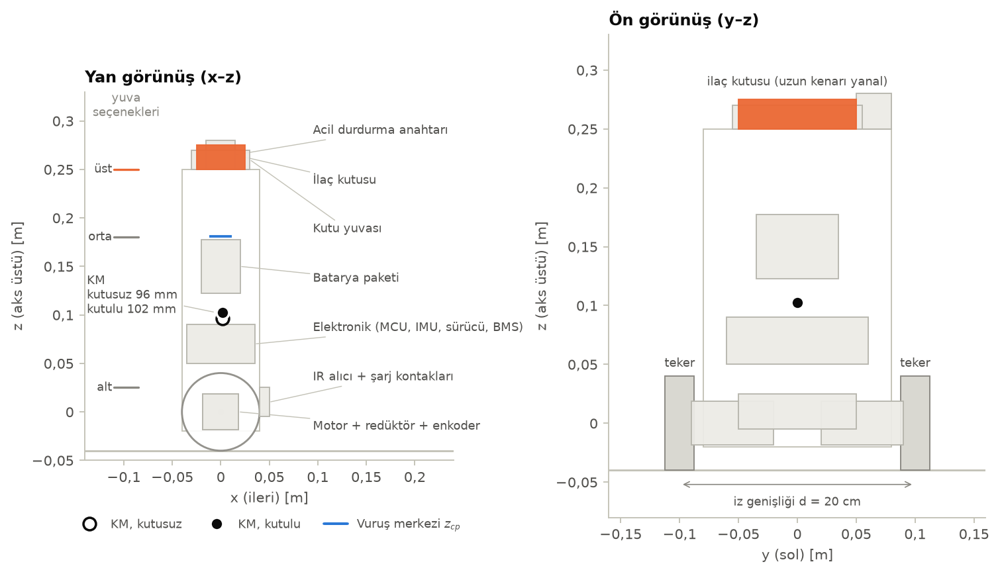
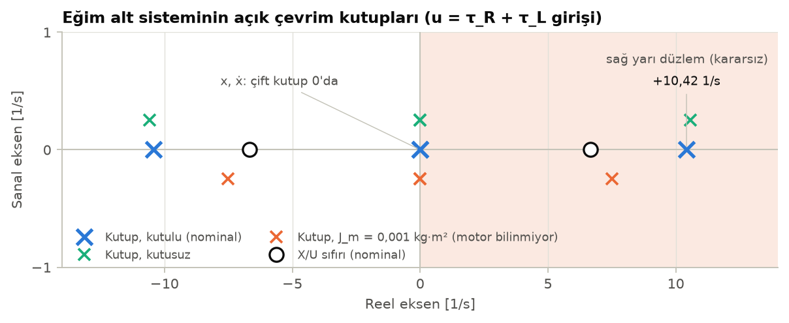
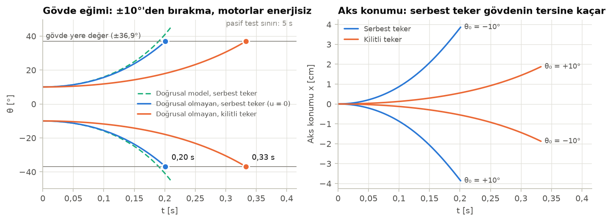
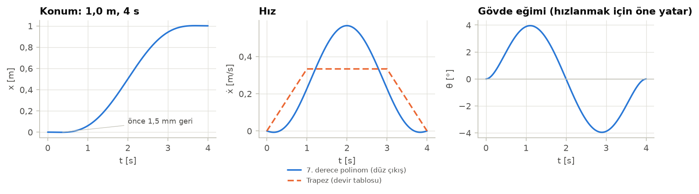
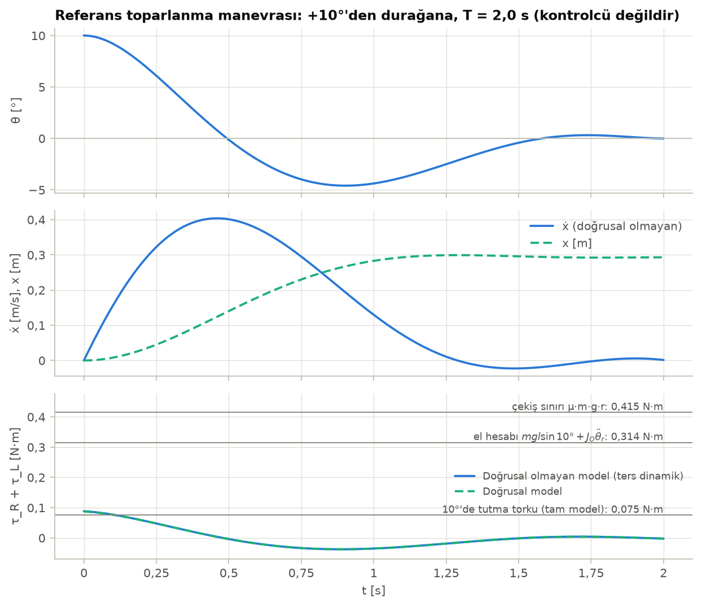
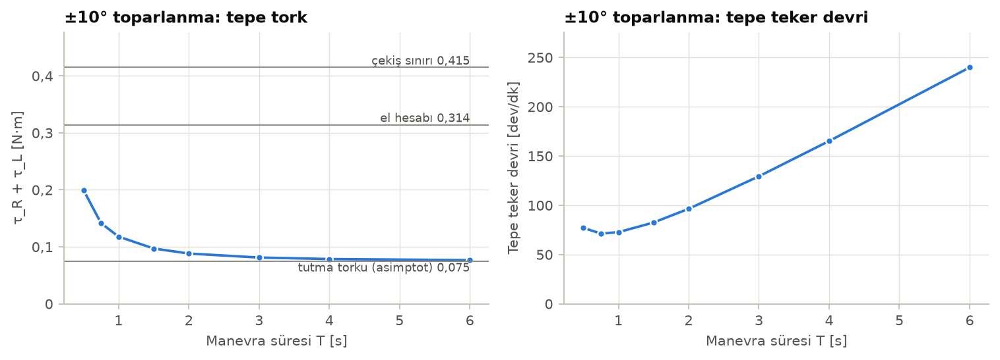
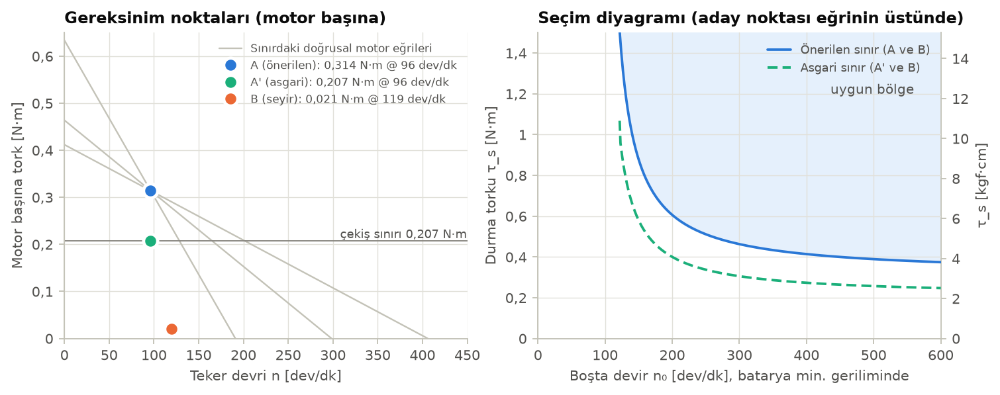
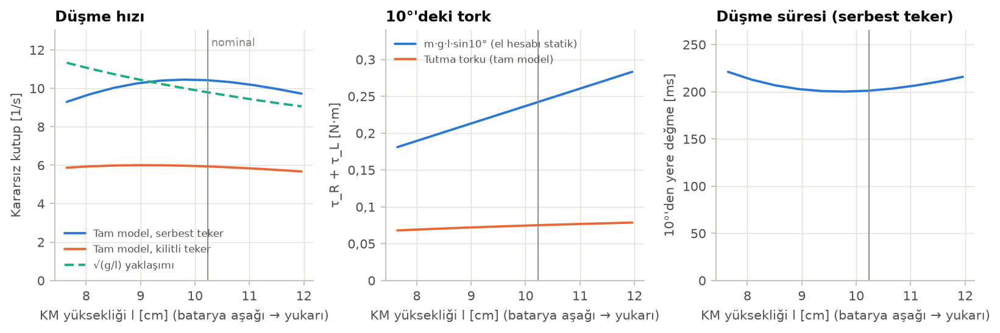
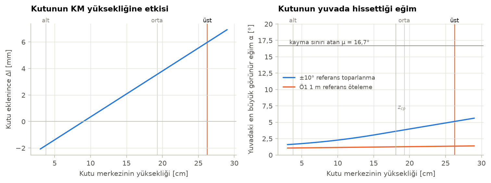

<!-- Otomatik üretildi (python -m denge). Düzenlemek için docs/sablon/hafta03.md ve parametreler.toml dosyalarını değiştirin. -->
# 3. Hafta: Ters Sarkaç Modeli, Motor Tork/Devir Hesapları ve İlaç Kutusu Yuvası Kütle Merkezi Analizi

| | |
|---|---|
| **Proje** | YTÜ EEF Çok Disiplinli Tasarım Projesi, 2026-2027 Güz: İki Tekerlekli Ev İçi Hasta Destek Robotu |
| **Hazırlayan** | Sefa Nurali Uçak (23015008), Kontrol ve Otomasyon Mühendisliği, Modül A ve E |
| **Toplantı** | 3. hafta danışman toplantısı, 19 Ekim 2026 (Parça Seçimi, Mimari ve Tasarım Toplantısı) |
| **Belge** | Parametre sürümü 0.1, üretim 18.10.2026. `parametreler.toml` dosyasından `python -m denge` ile üretilir. |

> **Danışman planındaki teslimat:** "Ters sarkaç matematiksel modeli, motor tork/hız hesapları ve ilaç kutusu yuvasının kütle merkezi analizi dokümanı."
>
> **Durum:** Motor, teker ve batarya henüz alınmadı. Bu belgedeki **bütün fiziksel parametreler tahminidir** (§2). Her birinin kaynağı ve makul aralığı parametre dosyasında yazılıdır. Parçalar gelince değerler ölçülecek, dosya güncellenecek ve belge aynı komutla yeniden üretilecek. Kontrolcü tasarlanmadı: kontrol yöntemi 6. haftada seçilecek. Model PID, LQR ve MPC'nin üçüne de temel olacak biçimde verilmiştir.

## Özet

| Büyüklük | Değer | Bölüm |
|---|---|---|
| Toplam kütle (kutulu / kutusuz) | 1,51 / 1,46 kg | §2 |
| Aks → KM uzaklığı $l$ (kutusuz / kutulu, üst yuva) | 96,4 / 102,3 mm | §5.2 |
| Açık çevrim kararsız kutup (kutulu) | +10,42 1/s (zaman sabiti 96 ms) | §3.6 |
| ±10°'den bırakılınca gövdenin yere değmesi (motorlar enerjisiz) | 0,20 s (serbest teker) ile 0,33 s (kilitli teker) arası | §3.7 |
| ±10° toparlanma torku, istenen el hesabı (iki motor toplamı) | 0,314 N·m | §4.2 |
| Aynı iş, tam model, $T$ = 2,0 s referans manevra ($J_m$ = 0 … 0,0025 kg·m²) | 0,088 … 0,306 N·m | §4.3 |
| **Önerilen motor gereksinimi** (motor başına, teker milinde, batarya min. geriliminde) | **≥ 0,314 N·m (3,2 kgf·cm) @ 96 dev/dk; boşta devir > 119 dev/dk** | §4.5 |
| Enkoder | ≥ 1257 sayım / teker devri (x4 kod çözme sonrası) | §4.6 |
| **Önerilen yuva** | Üst plakada, aksın tam üstünde ($x = y = 0$), kutu yatık ve uzun kenarı yanal; boşluk ≤ 2 mm, duvar ≈ 20 mm | §5.5 |

**Öne çıkan bulgular**

1. **El hesabı ($m g l \sin 10° + J_O\ddot\theta$) muhafazakârdır, ama ne kadar muhafazakâr olduğu bilinmeyen motora bağlıdır.** Rotor ataleti ihmal edilirse ($J_m = 0$) tam modelde 10°'de tutma torku $m g l \sin 10°$'nin yalnızca %31'idir, çünkü tekeri ileri iten tork gövdeyi de doğrultur. Ancak teker miline yansıyan rotor ataleti $J_m = J_\text{rotor} N^2$ arttıkça bu etki kaybolur: $J_m$ = 0,0025 kg·m²'de tutma torku 3,0 katına çıkar ve referans manevra el hesabına yaklaşır. Motor seçilene kadar el hesabı × emniyet katsayısı tasarım değeri olarak tutuldu (§4.3).
2. **Çekiş sınırı:** Zemine aktarılabilecek en büyük toplam tork ≈ 0,415 N·m'dir (μ = 0,7). Önerilen motor gereksinimi bunun üstündedir. Bu, böyle bir motorda tork darboğazı olmayacağı, sınırı zeminin koyacağı anlamına gelir. Kontrolcünün tork doyumu çekiş sınırına göre ayarlanmalıdır [öneri].
3. **$\sqrt{g/l}$ bu robot için yanıltıcıdır.** Tekerler hafif olduğundan serbest tekerli açık çevrim kutbu KM yüksekliğiyle monoton değişmez: batarya 3 → 23 cm taşınınca kutup 9,29 … 10,45 1/s aralığında kalır. $\sqrt{g/l}$ ise 11,33 → 9,06 1/s düşüş öngörür. Buna karşılık 10°'deki statik tork %56 artar (§5.4).
4. **Kutunun dengeye etkisi küçüktür.** Kutu (50 g, tahmini) toplam kütlenin %3,3'idir. Üst yuvada kutu eklenince $l$ 6,0 mm artar, kutup %−1,5 değişir. Bu yüzden aynı kazançlar kutulu ve kutusuz çalışmalıdır. Final testlerinin hepsi kutulu olduğundan kazançlar yine de kutuyla ayarlanmalıdır [öneri] (§5.2).
5. **Yere değme açısı ±36,9°'dir.** Bu sınırı gövdenin aksın altındaki köşeleri belirler. Toparlanmadaki aşım bu açıya yaklaşırsa iki teker dışında bir parça yere değer ve alt test düşer (şartname §7). Aksın altındaki parçalar teker yarıçapı içinde kalırsa hiç değmez [öneri] (§5.6).
6. **Pasif kararlılık ön testi tasarım gereği sağlanır.** KM aksın üstünde olduğu sürece robot enerjisizken ±10°'den 0,20–0,33 s içinde düşer, yani 5 s sınırının yaklaşık 15 katı payla. KM aksın altına inerse robot pasif kararlı olur ve şartname §4.1 ihlal edilir; bu durum testlerde yakalanır (§3.7).
7. **Mete'ye uyarı:** 6S Li-ion paket tam doluyken 25,2 V olur ve "ana besleme en fazla 24 V DC" sınırını aşabilir. Sınırın nominal mi tepe değer mi olduğu danışmana sorulmalıdır [doğrulanamadı]. 3S veya 4S güvenlidir (§4.5).

---

## 1. Kapsam, kaynaklar ve varsayımlar

**Kaynak önceliği.** Haftalık görev ve teslimatlar için danışmanın ekip iş planı, teknik kısıtlar için teknik şartname TR v14 (24 Eylül 2026) esas alındı. Bu belgede kullanılan şartname maddeleri:

| Madde | İçerik | Bu belgede |
|---|---|---|
| §4.1 Mekanik düzen | Yalnız iki ana teker; üçüncü teker veya destek yok | Model iki tekerli; yere değme açısı §5.6 |
| §4.1 Aktif denge, pasif kararlılık ön testi | Enerjisizken ±10°'den bırakılınca 5 s içinde dik konuma dönmemeli, pasif dik kalmamalı | §3.7 |
| §4.1 Güç | Ana besleme ≤ 24 V DC | §4.5 batarya tablosu |
| §4.1 Yük | İlaç kutusu görev boyunca sabit kalır, gövdeye monte edilmez | §5 |
| §7 Ortak test protokolü | Düz, sert, kuru zemin; kutu bütün testlerde taşınır; iki teker dışı temas alt testi düşürür | §4.4, §5 |
| §8 Ö1 | 30 s denge; ≈1 m ileri/geri + 3 s dur; ±10°'den 10 s içinde toparlanma | §4.1–4.3 |
| §8 Ö2 | ≈0,5 m ileri/geri, ≈90° dönüş, 2 s içinde tepki | §4.1 |

**Şartnamede hız veya süre sınırı yoktur.** Ö1/Ö2 hareketleri için süre yalnız tepki (2 s) ve bekleme (3 s) olarak tanımlıdır. Bu yüzden hareket süreleri bu belgede tasarım hedefi olarak seçildi ve [öneri] diye işaretlendi (§2.4).

**Varsayımlar.** Rijit gövde; tekerler kaymadan yuvarlanır ve yanal kaymaz; zemin düz ve yataydır (§7); tekerler ince disktir; motor endüktansı ihmal edilir; kutu yuvada gövdeyle birlikte hareket eder (kayma etkisi §5.3'te ayrıca ele alındı).

**Etiketler.** *tahmini*: ölçülmemiş fiziksel değer. *[öneri]*: danışman planında veya şartnamede bulunmayan, bu belgenin önerdiği seçim. *[doğrulanamadı]*: kaynaklarda doğrulanamayan bilgi.

## 2. Parametreler

### 2.1 Robotun fiziksel parametreleri (hepsi tahmini)

Aşağıdaki 36 parametre `parametreler.toml` dosyasından otomatik alınmıştır. Hiçbiri ölçülmemiştir. Testler, fiziksel bir parametrenin "tahmini" ya da "ölçülmüş" dışında bir durumla girilmesini engeller.

| Parametre | Değer | Birim | Aralık | Durum | Kaynak |
| --- | ---: | --- | ---: | --- | --- |
| `teker.yaricap` | 0,04 | m | 0,0325 – 0,05 | tahmini | Mühendislik tahmini: hobi robot tekerleri yaygın olarak Ø65–Ø100 mm; nominal Ø80 mm seçildi. |
| `teker.kutle` | 0,06 | kg | 0,03 – 0,12 | tahmini | Mühendislik tahmini: kauçuk lastik + göbek + kaplin, teker başına 30–120 g. |
| `teker.atalet_katsayisi` | 0,5 | - | 0,5 – 0,9 | tahmini | J_w = k·m_w·r². Dolu disk için k = 0,5; kütlesi lastikte toplanan tekerde k 1'e yaklaşır. |
| `teker.genislik` | 0,025 | m | 0,015 – 0,04 | tahmini | Mühendislik tahmini (yalnız çizim için). |
| `teker.iz_genisligi` | 0,2 | m | 0,15 – 0,25 | tahmini | Mühendislik tahmini: iki teker merkezi arası = şasi genişliği (~0,16 m) + motor/göbek payı. |
| `motor.rotor_ataleti_yansimis` | 0 | kg·m² | 0 – 0,0025 | tahmini | Bilinmiyor, nominalde ihmal edildi. Teker miline yansıyan değer J_rotor·N². Veri sayfasında varsa oradan alınacak, yoksa serbest yavaşlama (coast-down) deneyiyle tanılanacak. Aralığın üst sınırı kaba tahmin [doğrulanamadı]. |
| `motor.viskoz_surtunme` | 0 | N·m·s/rad | 0 – 0,02 | tahmini | Bilinmiyor, nominalde ihmal edildi. Teker–gövde arası redüktör viskoz sürtünmesi; motor seçilince tanılanacak. Aralık kaba tahmin [doğrulanamadı]. |
| `batarya.seri_hucre` | 3 | - | 3 – 6 | tahmini | Varsayım: 3S Li-ion. Şartname §4.1 ana besleme ≤ 24 V DC. Mete'nin seçimi bekleniyor. |
| `batarya.hucre_gerilimi_min` | 3 | V | 2,5 – 3,3 | tahmini | Li-ion hücre boşalma sonu (tipik ~3,0 V); gerçek değeri BMS kesim eşiği belirler. |
| `batarya.hucre_gerilimi_nominal` | 3,6 | V | 3,6 – 3,7 | tahmini | Li-ion hücre nominal gerilimi (3,6–3,7 V). |
| `batarya.hucre_gerilimi_max` | 4,2 | V | 4,1 – 4,2 | tahmini | Li-ion hücre tam dolu gerilimi (4,2 V). |
| `govde.motor.kutle` | 0,15 | kg | 0,08 – 0,2 | tahmini | Mühendislik tahmini: 25–37 mm gövdeli, enkoderli redüktörlü DC motorların tipik kütle aralığı (adet başına). |
| `govde.motor.konum` | (0,000; 0,055; 0,000) | m | - | tahmini | Tahmini yerleşim: motor mili teker aksıyla eş eksenli (z = 0), gövde tekerin iç tarafında. |
| `govde.motor.boyut` | (0,037; 0,070; 0,037) | m | - | tahmini | Tahmini motor zarfı: Ø37 × 70 mm sınıfı. |
| `govde.sasi.kutle` | 0,4 | kg | 0,25 – 0,6 | tahmini | Mühendislik tahmini: 3–4 katlı PLA/akrilik plaka + aralayıcı + braket; malzemeye göre 0,25–0,60 kg. |
| `govde.sasi.konum` | (0,000; 0,000; 0,115) | m | - | tahmini | Gövde zarfının (z = −0,02…0,25 m) ortası; kütlenin yükseklik boyunca düzgün dağıldığı varsayıldı. |
| `govde.sasi.boyut` | (0,080; 0,160; 0,270) | m | - | tahmini | Tahmini gövde zarfı: 8 cm derinlik × 16 cm genişlik × 27 cm yükseklik. |
| `govde.elektronik.kutle` | 0,2 | kg | 0,1 – 0,3 | tahmini | Mühendislik tahmini: kart + sürücü + regülatör + BMS + kablo/konnektör toplamı. |
| `govde.elektronik.konum` | (0,000; 0,000; 0,070) | m | - | tahmini | Tahmini yerleşim: 1. kat (z ≈ 5–9 cm). |
| `govde.elektronik.boyut` | (0,070; 0,120; 0,040) | m | - | tahmini | Tahmini zarf. |
| `govde.batarya.kutle` | 0,3 | kg | 0,15 – 0,45 | tahmini | Mühendislik tahmini: 3S2P 18650 paket (6 hücre × ~45–50 g + sargı). 3S1P–4S2P için aralık 0,15–0,45 kg. |
| `govde.batarya.konum` | (0,000; 0,000; 0,150) | m | - | tahmini | Tahmini yerleşim: 2. kat (z ≈ 12–18 cm). Bataryanın yüksekliği KM'yi en çok etkileyen karardır (bkz. doküman §5.4). |
| `govde.batarya.boyut` | (0,040; 0,070; 0,055) | m | - | tahmini | Tahmini 3S2P 18650 paket zarfı. |
| `govde.acil_durdurma.kutle` | 0,04 | kg | 0,02 – 0,08 | tahmini | Mühendislik tahmini: panel tipi mantar buton / anahtar. |
| `govde.acil_durdurma.konum` | (0,000; 0,065; 0,265) | m | - | tahmini | Tahmini yerleşim: erişilebilir olsun diye üst plakada, kutu yuvasının yanında. |
| `govde.acil_durdurma.boyut` | (0,030; 0,030; 0,030) | m | - | tahmini | Tahmini zarf. |
| `govde.ir_ve_sarj_kontaklari.kutle` | 0,05 | kg | 0,02 – 0,1 | tahmini | Mühendislik tahmini; Ömer Faruk'un istasyon/IR tasarımına bağlı. |
| `govde.ir_ve_sarj_kontaklari.konum` | (0,045; 0,000; 0,010) | m | - | tahmini | Varsayım: ön yüzde, istasyon yüksekliğine uysun diye alçakta. Önde mi arkada mı olacağı belli değil. |
| `govde.ir_ve_sarj_kontaklari.boyut` | (0,010; 0,100; 0,030) | m | - | tahmini | Tahmini zarf. |
| `govde.zarf.x_aralik` | (−0,040; 0,040) | m | - | tahmini | Tahmini gövde derinliği 8 cm, aksa göre simetrik. |
| `govde.zarf.z_aralik` | (−0,020; 0,250) | m | - | tahmini | Tahmini: alt plaka aksın 2 cm altında, üst plaka 25 cm yukarıda. |
| `yuk.kutu.kutle` | 0,05 | kg | 0,02 – 0,15 | tahmini | Mühendislik tahmini: küçük karton ilaç kutusu (aspirin vb.). Kutu seçilince tartılacak. |
| `yuk.kutu.boyut` | (0,050; 0,100; 0,025) | m | - | tahmini | Tahmini kutu ölçüsü [x, y, z]: 10 × 5 × 2,5 cm, yatık, uzun kenarı yanal (y). Kutu seçilince ölçülecek. |
| `yuk.kutu.surtunme` | 0,3 | - | 0,2 – 0,5 | tahmini | Mühendislik tahmini: karton – PLA/akrilik statik sürtünme katsayısı. |
| `yuk.yuva.kutle` | 0,05 | kg | 0,02 – 0,1 | tahmini | Mühendislik tahmini: 3B baskı / akrilik cep tipi yuva. |
| `zemin.surtunme` | 0,7 | - | 0,5 – 0,9 | tahmini | Mühendislik tahmini: kauçuk teker ile düz, sert, kuru iç mekân zemini (şartname §7) arası statik sürtünme. |

### 2.2 Kütle bütçesi ve yerleşim

Gövde, tahmini bileşenlerin kütle ve konumlarından kurulmuştur (Şekil 1). Bileşenler dikdörtgen prizma olarak alınmış, atalet tensörü paralel eksen teoremiyle hesaplanmıştır.

| Bileşen | Kütle [g] | x [mm] | z [mm] | Gövde kütlesindeki pay | m·z katkısı [g·m] |
| --- | ---: | ---: | ---: | ---: | ---: |
| Motor + redüktör + enkoder (sol) | 150 | 0 | 0 | %10,8 | 0,0 |
| Motor + redüktör + enkoder (sağ) | 150 | 0 | 0 | %10,8 | 0,0 |
| Şasi yapısı | 400 | 0 | 115 | %28,8 | 46,0 |
| Elektronik (MCU, IMU, sürücü, BMS) | 200 | 0 | 70 | %14,4 | 14,0 |
| Batarya paketi | 300 | 0 | 150 | %21,6 | 45,0 |
| Acil durdurma anahtarı | 40 | 0 | 265 | %2,9 | 10,6 |
| IR alıcı + şarj kontakları | 50 | 45 | 10 | %3,6 | 0,5 |
| Kutu yuvası | 50 | 0 | 260 | %3,6 | 13,0 |
| İlaç kutusu | 50 | 0 | 262 | %3,6 | 13,1 |
| **Gövde toplamı** (tekerler hariç) | **1390** | 1,6 | 102,3 | %100 | 142,2 |
| Tekerler (2 adet, aksta) | 120 | 0 | 0 | - | 0 |



*Şekil 1: Tahmini yerleşim, yan ve ön görünüş. Koordinat orijini teker aksının orta noktasıdır; x ileri, z gövde ekseni boyunca yukarıdır. Turuncu: ilaç kutusu (önerilen üst yuvada). Siyah noktalar kutusuz ve kutulu kütle merkezi; mavi çizgi vuruş merkezi (§5.5). Soldaki işaretler değerlendirilen üç yuva yüksekliğidir.*

### 2.3 Modele giren türetilmiş parametreler

| Büyüklük | Sembol | Kutusuz | Kutulu | Birim |
| --- | :---: | ---: | ---: | --- |
| Gövde kütlesi (motor statoru dahil) | $m_b$ | 1,340 | 1,390 | kg |
| Aks → gövde KM uzaklığı | $l$ | 96,4 | 102,3 | mm |
| Yunuslama ataleti (KM'de) | $I_{yy}$ | 9,84 | 11,18 | g·m² |
| Yuvarlanma ataleti (KM'de) | $I_{xx}$ | 11,86 | 13,23 | g·m² |
| Sapma ataleti (KM'de) | $I_{zz}$ | 2,99 | 3,04 | g·m² |
| Teker kütlesi (bir) | $m_w$ | 60 | 60 | g |
| Teker dönme ataleti (bir) | $J_w$ | 48,0 | 48,0 | g·cm² |
| Teker yarıçapı / iz genişliği | $r$, $d$ | 40,0 / 200 | 40,0 / 200 | mm |
| Yansıyan rotor ataleti / viskoz sürtünme | $J_m$, $b$ | 0 / 0 (ihmal) | 0 / 0 (ihmal) | kg·m², N·m·s |

### 2.4 Şartname değerleri ve tasarım hedefleri

| Parametre | Değer | Birim | Durum | Kaynak |
| --- | ---: | --- | --- | --- |
| `yuk.yuva.duvar_yuksekligi` | 0,02 | m | [öneri] | Kutu yüksekliğinin ~%80'i [öneri]; kutunun KM'si duvar üst kenarının altında kalır. |
| `yuk.yuva.bosluk` | 0,002 | m | [öneri] | Kutu ile yuva duvarı arası boşluk, her yönde [öneri]. Mete üretecek. |
| `yuk.yuva.x` | 0 | m | [öneri] | Yuva tam aksın üstünde [öneri]: kutu takılıp çıkarılınca denge açısı (trim) değişmesin. |
| `yuk.yuva.secenek.ust` | 0,25 | m | [öneri] | Üst plakanın üstü. |
| `yuk.yuva.secenek.orta` | 0,18 | m | [öneri] | Batarya ile üst plaka arası (kat düzeninin değişmesini gerektirir). |
| `yuk.yuva.secenek.alt` | 0,025 | m | [öneri] | Motorların üstü, elektronik katının altı. |
| `yuk.yuva.onerilen` | ust | - | [öneri] | Doküman §5.5'teki karşılaştırmanın sonucu [öneri]. |
| `sartname.max_gerilim` | 24 | V | şartname | Şartname TR v14 §4.1 Güç: ana besleme en fazla 24 V DC. |
| `sartname.pasif_test_acisi` | 10 | ° | şartname | Şartname TR v14 §4.1 Pasif kararlılık ön testi: +10° ve −10°. |
| `sartname.pasif_test_suresi` | 5 | s | şartname | Şartname TR v14 §4.1: 5 s içinde dik konuma dönmemeli / pasif dik kalmamalı. |
| `sartname.toparlanma_acisi` | 10 | ° | şartname | Şartname TR v14 §8 Ö1-4: yaklaşık +10° ve −10° başlangıç eğimi. |
| `sartname.toparlanma_suresi` | 10 | s | şartname | Şartname TR v14 §8 Ö1-4: 10 s içinde toparlanma. |
| `sartname.o1_mesafe` | 1 | m | şartname | Şartname TR v14 §8 Ö1-2/Ö1-3: yaklaşık 1 m ileri ve geri. |
| `sartname.o1_bekleme` | 3 | s | şartname | Şartname TR v14 §8 Ö1-2/Ö1-3: 3 s durma. |
| `sartname.o2_mesafe` | 0,5 | m | şartname | Şartname TR v14 §8 Ö2: ileri/geri komutunda yaklaşık 0,5 m. |
| `sartname.o2_donus` | 90 | ° | şartname | Şartname TR v14 §8 Ö2: dönüş komutunda yaklaşık 90°. |
| `sartname.komut_tepki_suresi` | 2 | s | şartname | Şartname TR v14 §7 ve §8 Ö2: fiziksel tepki 2 s içinde. |
| `hedef.o1_sure` | 4 | s | [öneri] | Şartnamede süre sınırı yok. 1 m için 4 s (ort. 0,25 m/s): iç mekân için güvenli, kameranın izleyebileceği hız [öneri]. |
| `hedef.o2_sure` | 3 | s | [öneri] | Şartnamede süre sınırı yok. 0,5 m için 3 s [öneri]. |
| `hedef.donus_sure` | 2 | s | [öneri] | Şartnamede süre sınırı yok. 90° yerinde dönüş için 2 s [öneri]. |
| `hedef.profil_ivme_orani` | 0,25 | - | [öneri] | Trapez hız profili: sürenin %25'i hızlanma, %25'i yavaşlama [öneri]. |
| `hedef.hiz_payi` | 1,5 | - | [öneri] | Motor, seyir tepe hızının 1,5 katına kadar tork verebilmeli: denge düzeltmeleri için hız payı [öneri]. |
| `hedef.el_toparlanma_suresi` | 0,5 | s | [öneri] | El hesabındaki dinamik pay için θ'nın 10°'den 0°'a dönüş süresi (bang-bang profil) [öneri]. |
| `hedef.referans_manevra_suresi` | 2 | s | [öneri] | Kontrolcüden bağımsız referans toparlanma manevrasının süresi (durağandan durağana) [öneri]. Şartname sınırı 10 s. |
| `hedef.emniyet_katsayisi` | 2 | - | [öneri] | Tork emniyet katsayısı [öneri]: parametreler tahmini, kontrolcü aşımı, batarya gerilim düşümü, ölü bölge. |
| `hedef.kontrol_frekansi` | 200 | Hz | [öneri] | Denge döngüsü frekansı [öneri]; kararsız kutbun (~10 rad/s) çok üstünde. |
| `hedef.hiz_kestirim_penceresi` | 0,01 | s | [öneri] | Enkoderden hız kestirimi için sayım penceresi (200 Hz'de 2 örnek) [öneri]. |
| `hedef.hiz_cozunurlugu` | 0,02 | m/s | [öneri] | Ö1'deki 3 s durmada hız kestiriminin bir sayımlık nicemleme adımı en fazla 2 cm/s olsun [öneri]. |
| `hedef.yere_degme_min` | 25 | ° | [öneri] | ±10° başlangıç + toparlanmadaki aşım payı. İki teker dışında bir parçanın yere değmesi alt testi düşürür (şartname §7) [öneri]. |

## 3. Matematiksel model

### 3.1 Koordinatlar

Genelleştirilmiş koordinatlar $q = (X, Y, \psi, \theta, \varphi_R, \varphi_L)$:

- $X, Y$: aks orta noktasının zemindeki konumu; $x$: yön boyunca alınan yol ($\dot x = v$),
- $\psi$: sapma (yaw), sola dönüş pozitif,
- $\theta$: gövde eğimi (pitch), **ileri eğim pozitif** (KM aksın önüne geçer),
- $\varphi_R, \varphi_L$: sağ/sol teker dönüş açısı.

Girişler teker millerindeki motor torklarıdır: $\tau_R, \tau_L$. Motor torku teker ile gövde arasında etkir, yani tepkisi gövdeye gelir. Tekerler kaymadan yuvarlanır ve yanal kaymaz:

$$
r\dot\varphi_R = v + \tfrac{d}{2}\dot\psi,\qquad r\dot\varphi_L = v - \tfrac{d}{2}\dot\psi,\qquad -\dot X\sin\psi + \dot Y\cos\psi = 0 .
$$

Bu kısıtlar holonom değildir. Bu yüzden Lagrange denklemleri tüm koordinatlarda yazılır ve kısıtlara uyan serbest hızlar $\nu = (v, \dot\psi, \dot\theta)$ üzerine izdüşürülür. Bu yöntem Lagrange–d'Alembert ilkesidir: kısıt kuvvetleri iş yapmadığı için izdüşümde düşer.

### 3.2 Lagrange formülasyonu

Gövde KM'si $(X + l\sin\theta\cos\psi,\; Y + l\sin\theta\sin\psi,\; r + l\cos\theta)$ noktasındadır. Gövdenin açısal hızı gövde eksenlerinde $(-\dot\psi\sin\theta,\; \dot\theta,\; \dot\psi\cos\theta)$ olur. Kinetik ve potansiyel enerji:

$$
T = \tfrac12 m_b \lVert \dot{\mathbf p}_b \rVert^2 + \tfrac12\left(I_{xx}\dot\psi^2\sin^2\theta + I_{yy}\dot\theta^2 + I_{zz}\dot\psi^2\cos^2\theta\right)
 + \sum_{i=R,L}\left[\tfrac12 m_w \lVert \dot{\mathbf p}_i \rVert^2 + \tfrac12 J_w\dot\varphi_i^2 + \tfrac12 K_w\dot\psi^2 + \tfrac12 J_m(\dot\varphi_i - \dot\theta)^2\right]
$$

$$
V = m_b g\, l\cos\theta, \qquad \mathcal L = T - V .
$$

Son terim, rotor ataletinin teker miline yansımasıdır ($J_m = J_\text{rotor}N^2$). Motor ve redüktör sürtünmesi ($b$) teker–gövde bağıl hızıyla orantılıdır. Genelleştirilmiş kuvvetler:

$$
Q_{\varphi_i} = \tau_i - b(\dot\varphi_i - \dot\theta), \qquad Q_\theta = -\sum_i\left[\tau_i - b(\dot\varphi_i - \dot\theta)\right].
$$

Türetim `denge/model.py` içinde sembolik olarak (sympy) yapılmış ve aşağıdaki el ile yazılmış biçimle birebir eşleştirilmiştir (test: `test_sembolik_turetim_el_ile_yazilan_denklemlerle_ayni`).

### 3.3 Doğrusal olmayan hareket denklemleri

Kısaltmalar:

$$
M_x = m_b + 2m_w + \frac{2(J_w + J_m)}{r^2},\quad
a_{12}(\theta) = m_b l\cos\theta - \frac{2J_m}{r},\quad
a_{22} = I_{yy} + m_b l^2 + 2J_m,
$$

$$
J_\psi(\theta) = I_{xx}\sin^2\theta + I_{zz}\cos^2\theta + m_b l^2\sin^2\theta + 2K_w + \frac{m_w d^2}{2} + \frac{(J_w + J_m)\,d^2}{2r^2},
\qquad \omega_b = \frac{v}{r} - \dot\theta .
$$

**İleri hareket ($v$):**

$$
M_x\dot v + a_{12}(\theta)\ddot\theta - m_b l\sin\theta\,(\dot\theta^2 + \dot\psi^2) = \frac{\tau_R + \tau_L}{r} - \frac{2b}{r}\,\omega_b
$$

**Sapma ($\psi$):**

$$
J_\psi(\theta)\ddot\psi + 2(I_{xx} - I_{zz} + m_b l^2)\sin\theta\cos\theta\,\dot\theta\dot\psi + m_b l\sin\theta\, v\dot\psi = \frac{d}{2r}(\tau_R - \tau_L) - \frac{b\,d^2}{2r^2}\dot\psi
$$

**Eğim ($\theta$):**

$$
a_{12}(\theta)\dot v + a_{22}\ddot\theta - (I_{xx} - I_{zz} + m_b l^2)\sin\theta\cos\theta\,\dot\psi^2 - m_b g l\sin\theta = -(\tau_R + \tau_L) + 2b\,\omega_b
$$

İleri denklemdeki $m_b l\sin\theta\,\dot\psi^2$ ve sapma denklemindeki $m_b l\sin\theta\, v\dot\psi$ terimleri holonom olmayan kısıttan gelir: dönerken öne eğik KM bir çember üzerinde hareket eder. Bu terimler naif Lagrange yazımında (x'i sıradan koordinat sayınca) kaybolur.

Tekerler gövdeye kilitliyse (redüktör geri sürülemezse) robot tek parça yuvarlanır ve tek serbestlik dereceli olur:

$$
\left[I_{yy} + 2J_w + m_b(l^2 + 2lr\cos\theta + r^2) + 2m_w r^2\right]\ddot\theta - m_b l r\sin\theta\,\dot\theta^2 - m_b g l\sin\theta = 0 .
$$

### 3.4 θ = 0 civarında doğrusallaştırma

$\theta \approx 0$, $\dot\theta \approx 0$, $v \approx 0$, $\dot\psi \approx 0$ için $\sin\theta \approx \theta$, $\cos\theta \approx 1$ alınır ve ikinci dereceden terimler atılır. Bu durumda eğim/ileri ile sapma **ayrışır**:

$$
\underbrace{\begin{bmatrix} M_x & a_{12} \\ a_{12} & a_{22}\end{bmatrix}}_{\mathbf M}\begin{bmatrix}\ddot x \\ \ddot\theta\end{bmatrix}
= \begin{bmatrix} 0 \\ m_b g l \end{bmatrix}\theta
+ 2b\begin{bmatrix} -1/r^2 & 1/r \\ 1/r & -1 \end{bmatrix}\begin{bmatrix}\dot x \\ \dot\theta\end{bmatrix}
+ \begin{bmatrix} 1/r \\ -1 \end{bmatrix} u,
\qquad J_{\psi 0}\,\ddot\psi = \frac{d}{2r}u_\psi - \frac{b\,d^2}{2r^2}\dot\psi
$$

Burada $u = \tau_R + \tau_L$ (ortak tork), $u_\psi = \tau_R - \tau_L$ (fark tork), $a_{12} = m_b l - 2J_m/r$ ve $J_{\psi 0} = J_\psi(0)$'dır. Motorlara verilecek komut $\tau_{R,L} = (u \pm u_\psi)/2$ olur. Doğrusallaştırmanın doğruluğu, doğrusal olmayan modelin sayısal Jakobiyeniyle karşılaştırılarak test edilmiştir ($b \neq 0$, $J_m \neq 0$ dahil).

Nominal (kutulu) değerler: $M_x = 1{,}570$ kg, $a_{12} = 0{,}1422$ kg·m, $a_{22} = 0{,}02574$ kg·m², $\Delta = M_x a_{22} - a_{12}^2 = 0{,}02017$ kg²·m², $m_b g l = 1{,}395$ N·m, $J_{\psi 0} = 0{,}004890$ kg·m².

### 3.5 Durum-uzay modeli (A, B, C, D)

**Eğim + ileri alt sistemi.** Durum $\mathbf x = [x,\ \dot x,\ \theta,\ \dot\theta]^\mathsf{T}$, giriş $u = \tau_R + \tau_L$ [N·m]. $b = 0$ için kapalı biçim:

$$
A = \begin{bmatrix} 0 & 1 & 0 & 0 \\ 0 & 0 & -\dfrac{a_{12}\,m_b g l}{\Delta} & 0 \\ 0 & 0 & 0 & 1 \\ 0 & 0 & \dfrac{M_x\, m_b g l}{\Delta} & 0 \end{bmatrix},\qquad
B = \begin{bmatrix} 0 \\ \dfrac{a_{22} + a_{12} r}{r\Delta} \\ 0 \\ -\dfrac{M_x r + a_{12}}{r\Delta} \end{bmatrix},\qquad
C = I_4,\qquad D = 0_{4\times 1}.
$$

Sayısal (kutulu, nominal, SI birimler):

$$
A = \begin{bmatrix} 0 & 1 & 0 & 0 \\ 0 & 0 & -9{,}836 & 0 \\ 0 & 0 & 0 & 1 \\ 0 & 0 & 108{,}6 & 0 \end{bmatrix},\qquad B = \begin{bmatrix} 0 \\ 38{,}95 \\ 0 \\ -254{,}1 \end{bmatrix} .
$$

$C = I_4$ seçimi, durumların hepsinin ölçüldüğünü varsayar: $x, \dot x$ enkoderden, $\theta$ 5. haftanın filtresinden, $\dot\theta$ jiroskoptan gelir. $B_4 < 0$ olması şu demektir: ileri tork gövdeye geri yönde tepki uygular.

**Sapma alt sistemi.** Durum $[\psi,\ \dot\psi]^\mathsf{T}$, giriş $u_\psi = \tau_R - \tau_L$:

$$
A_\psi = \begin{bmatrix} 0 & 1 \\ 0 & 0 \end{bmatrix},\qquad B_\psi = \begin{bmatrix} 0 \\ 511{,}2 \end{bmatrix},\qquad C_\psi = I_2,\qquad D_\psi = 0 .
$$

**Ayrık model (MPC veya ayrık LQR için).** Sıfırıncı derece tutucu (ZOH), $T_s$ = 5 ms (200 Hz [öneri]):

$$
A_d = \begin{bmatrix} 1 & 0{,}0050000 & -1{,}2298\times 10^{-4} & -2{,}0494\times 10^{-7} \\ 0 & 1 & -0{,}049202 & -1{,}2298\times 10^{-4} \\ 0 & 0 & 1{,}0014 & 0{,}0050023 \\ 0 & 0 & 0{,}54307 & 1{,}0014 \end{bmatrix},\qquad B_d = \begin{bmatrix} 4{,}869\times 10^{-4} \\ 0{,}1948 \\ -0{,}003177 \\ -1{,}271 \end{bmatrix} .
$$

**Kontrol edilebilirlik ve gözlenebilirlik.** $(A, B)$ kontrol edilebilirlik rangı 4/4'tür, yani tam. $C = [x;\ \theta]$ ile (enkoder + IMU) gözlenebilirlik rangı 4/4'tür. Yalnız $\theta$ ölçülürse rang 2/4'e düşer: konum ve hız gözlenemez, bu yüzden enkoder şarttır (§4.6).

**Motor seçilince gerilim girişi.** Endüktans ihmal edilirse redüktörlü DC motor teker milinde $\tau = (K_t/R)V - (K_t K_e/R)\,\omega_b$ verir. İki motora aynı $V$ uygulanırsa model, $b \to b + K_tK_e/R$ ve $B \to B\cdot 2K_t/R$ değişiklikleriyle aynı kalır (`model.gerilim_girisli_durum_uzay`). $K_t, K_e, R$ değerleri veri sayfasından hesaplanır (`motor.MotorAdayi.motor_modeli`).

### 3.6 Transfer fonksiyonları ve açık çevrim kutuplar

$b = 0$ için kapalı biçimler:

$$
G_\theta(s) = \frac{\Theta(s)}{U(s)} = \frac{-K_\theta}{s^2 - p^2},\qquad
K_\theta = \frac{M_x r + a_{12}}{r\Delta},\qquad p^2 = \frac{M_x\, m_b g l}{\Delta}
$$

$$
G_x(s) = \frac{X(s)}{U(s)} = \frac{K_x\,(s^2 - z^2)}{s^2\,(s^2 - p^2)},\qquad
K_x = \frac{a_{22} + a_{12} r}{r\Delta},\qquad z^2 = \frac{m_b g l}{a_{22} + a_{12} r},
\qquad
G_\psi(s) = \frac{\Psi(s)}{U_\psi(s)} = \frac{d/(2rJ_{\psi 0})}{s^2}
$$

Sayısal (kutulu):

$$
G_\theta(s) = \frac{-254{,}1}{s^2 - 108{,}6} = \frac{-254{,}1}{(s - 10{,}42)(s + 10{,}42)},\qquad
G_x(s) = \frac{38{,}95\,(s^2 - 44{,}39)}{s^2\,(s^2 - 108{,}6)},\qquad
G_\psi(s) = \frac{511{,}2}{s^2}
$$

|  | Kutusuz [1/s] | Kutulu [1/s] |
| --- | ---: | ---: |
| Eğim kutupları (serbest teker, $u$ girişi) | ±10,58, 0, 0 | ±10,42, 0, 0 |
| Kilitli teker kutbu (redüktör geri sürülemezse) | ±6,01 | ±5,93 |
| Noktasal kütle, sabit pivot: $\sqrt{g/l}$ | 10,09 | 9,79 |
| $X/U$ sıfırları | ±6,79 | ±6,66 |
| Sapma kutupları | 0, 0 | 0, 0 |



*Şekil 2: Eğim alt sisteminin açık çevrim kutupları. Sağ yarı düzlemde bir kutup (+10,42 1/s) vardır, yani sistem açık çevrimde kararsızdır (test: `test_en_az_bir_kutup_sag_yari_duzlemde`). Turuncu: bilinmeyen rotor ataleti için örnek $J_m$ = 0,001 kg·m². Halkalar $X/U$'nun sıfırlarıdır.*

**Yorum ve kontrol tasarımına etkisi:**

- Kararsız kutup +10,42 1/s'dir, yani eğim hatası her 96 ms'de $e$ katına büyür. Önerilen 200 Hz döngü frekansı ($2\pi f$ = kutbun 121 katı) bunun için rahat bir paydır [öneri].
- $G_x$'te sağ yarı düzlemde bir sıfır vardır ($z$ = +6,66 1/s). Robot ileri gitmek için önce tekeri geri kaçırıp gövdeyi öne yatırmak zorundadır; bu, minimum fazlı olmayan davranıştır ve konum döngüsünün bant genişliğini sınırlar. Ö1'deki 1 m harekette bu geri kaçış milimetre düzeyindedir (§4.1).
- **PID:** iç döngü $G_\theta$, dış döngü (konum/hız) $G_x$. **LQR:** $(A, B)$ ve $C = I_4$; sapma için ayrıca $(A_\psi, B_\psi)$. **MPC:** $(A_d, B_d)$ ile tork sınırı (§4.4 çekiş sınırı) ve eğim sınırı (§5.6 yere değme açısı) kısıt olarak girilebilir.

### 3.7 Açık çevrim düşme simülasyonu (±10°)

Robot durağan hâlde ±10°'den bırakılır ve motorlar enerjisizdir ($u = 0$). Redüktörün geri sürülebilirliği motor seçilmeden bilinmediği için iki uç durum simüle edildi: **serbest teker** (redüktör serbest döner) ve **kilitli teker** (redüktör geri sürülemez, robot tek parça yuvarlanır). Simülasyon gövde yere değince durur (yere değme açısı ±36,9°, §5.6).



*Şekil 3: ±10°'den açık çevrim düşme. Kesikli çizgi doğrusal model. Gövde serbest tekerde 0,20 s'de, kilitli tekerde 0,33 s'de yere değer. ±10° düşmeler birbirinin aynadaki görüntüsüdür (test edildi).*

| Durum | Yere değme süresi | Aks yer değiştirmesi |
|---|---:|---:|
| Doğrusal olmayan, serbest teker | 0,201 s | 3,9 cm (gövdenin tersine) |
| Doğrusal olmayan, kilitli teker | 0,333 s | 1,9 cm (gövdeyle aynı yöne yuvarlanır) |
| Doğrusal model ($\theta_0\cosh pt$), serbest teker | 0,190 s | - |

**4. hafta pasif kararlılık ön testi için öngörü:** Hem serbest hem kilitli teker durumunda robot 5 s sınırının çok altında (0,20–0,33 s) düşer ve dikliğe hiç yaklaşmaz. Bu sonuç $l > 0$ olduğu sürece geçerlidir. Model, KM aksın altına indirildiğinde ($l < 0$) kararsız kutbun kaybolduğunu ve robotun pasif kararlı hâle geldiğini de gösterir (test: `test_km_aks_altindaysa_robot_pasif_kararli_olur`). Bu yüzden ağır parçaların (batarya) aksın altına taşınmaması gerekir. 4. hafta toplantısında kronometreyle ölçülecek düşme süresi bu öngörüyle karşılaştırılacaktır [öneri].

Doğrusal model yere değme süresini %6 kısa öngörür; ±10° civarında iki model örtüşür (Şekil 3), yani bu bölgede doğrusal model kontrol tasarımı için yeterlidir.

### 3.8 Bilinmeyen motor parametrelerinin kutba etkisi

Motor seçilmediği için yansıyan rotor ataleti $J_m$ ve sürtünme $b$ nominalde ihmal edildi. İkisi de kutbu belirgin biçimde yavaşlatır:

| $J_m$ [kg·m²] (ya da $b$) | Kararsız kutup [1/s] | Nominale göre |
| --- | ---: | ---: |
| 0,0000 | 10,42 | %0 |
| 0,0005 | 8,25 | %−21 |
| 0,0010 | 7,51 | %−28 |
| 0,0025 | 6,74 | %−35 |
| b = 0,005 N·m·s/rad | 8,01 | %−23 |
| b = 0,020 N·m·s/rad | 6,63 | %−36 |

Gerilim kontrollü bir sürücüde zıt EMK eşdeğer bir $b$ ekler ($K_tK_e/R$), bu da kutbu kilitli teker değerine doğru çeker. Bu yüzden motor geldiğinde ilk tanılanacak parametreler $J_m$ ve $b$'dir. Yöntem serbest yavaşlama (coast-down) deneyi ve veri sayfasıdır [öneri].

## 4. Motor tork/devir hesapları

Bütün torklar **teker milinde** (redüktör çıkışında) verilmiştir. "Toplam" iki motorun toplamı, "motor başı" tek motor içindir.

### 4.1 Ö1/Ö2 hareketleri için teker hızı ve devir

Simetrik trapez hız profili kullanıldı: sürenin oranı $\rho$ = 0,25 hızlanma, $\rho$ = 0,25 yavaşlama [öneri]. Mesafe $D$, süre $T$ için:

$$
v_\text{tepe} = \frac{D}{(1-\rho)T},\qquad a = \frac{v_\text{tepe}}{\rho T},\qquad n = \frac{60\, v}{2\pi r}\ \text{[dev/dk]},\qquad
\text{yerinde dönüşte } v = \frac{d}{2}\dot\psi .
$$

Sabit ivmede ($\ddot\theta = 0$) gereken toplam tork $\tau_R + \tau_L = M_x r a$, yerinde dönüşte fark torku $\tau_R - \tau_L = (2r/d)J_{\psi 0}\ddot\psi$'dir.

| Hareket | Miktar | Süre [s] [öneri] | Tepe teker hızı [m/s] | İvme | Teker devri [dev/dk] | İvme torku, motor başı [N·m] |
| --- | ---: | ---: | ---: | ---: | ---: | ---: |
| Ö1 ileri/geri | 1 m | 4,0 | 0,333 | 0,333 m/s² | 79,6 | 0,0105 |
| Ö2 ileri/geri | 0,5 m | 3,0 | 0,222 | 0,296 m/s² | 53,1 | 0,0093 |
| Ö2 yerinde 90° dönüş | 90° | 2,0 | 0,105 | 0,209 m/s² (teker çevresi) | 25,0 | 0,0020 |

Hareket için gereken tork, toparlanma torkunun yanında ihmal edilebilecek kadar küçüktür. Motor seçimini belirleyen hız değil, ±10° toparlanmasıdır.



*Şekil 4: Ö1 için 1 m / 4 s referans öteleme (düz çıkış ile, dinamik olarak tutarlı). Robot önce 1,5 mm geri kaçar (minimum fazlı olmayan sıfır), hızlanmak için 4,0°'ye kadar öne yatar. Yumuşak polinom profilin tepe hızı 0,57 m/s'dir (135 dev/dk), yani trapezin 1,70 katı. Devir tablosundaki hız payı (×1,5) bu farkı kapsar.*

### 4.2 ±10°'den toparlanma torku: istenen el hesabı

İstenen biçim, statik terim ile dinamik payın toplamıdır (iki motor toplamı):

$$
\tau_\text{top} = \underbrace{m_b g l\sin\theta_0}_{\text{statik}} + \underbrace{J_O\,\ddot\theta_r}_{\text{dinamik pay}},\qquad
J_O = I_{yy} + m_b l^2,\qquad \ddot\theta_r = \frac{4\theta_0}{t_r^2}
$$

Burada $m_b$ ve $l$ gövdeye aittir: tekerlerin ağırlığı aksta etkir ve moment üretmez. $\ddot\theta_r$, gövdenin $\theta_0$ = 10°'den 0°'a $t_r$ sürede dönmesi için gereken açısal ivmedir: sürenin yarısında hızlanır, yarısında yavaşlar ($t_r$ = 0,5 s [öneri]).

| Terim | Değer |
|---|---:|
| Statik: $m_b g l\sin 10°$ | 0,242 N·m |
| $J_O$ (aks etrafında) | 25,74 g·m² |
| $\ddot\theta_r$ | 2,79 rad/s² |
| Dinamik pay: $J_O\ddot\theta_r$ | 0,072 N·m |
| **Toplam (iki motor)** | **0,314 N·m** |
| Motor başına | 0,157 N·m (1,60 kgf·cm) |
| **Motor başına × emniyet katsayısı 2,0 [öneri]** | **0,314 N·m (3,2 kgf·cm)** |

Dönüş süresinin etkisi:

| $t_r$ [s] | $\ddot\theta_r$ [rad/s²] | Dinamik pay [N·m] | Toplam [N·m] | Motor başı [N·m] | Motor başı × SF=2,0 [kgf·cm] |
| --- | ---: | ---: | ---: | ---: | ---: |
| 0,3 | 7,76 | 0,200 | 0,442 | 0,221 | 4,51 |
| 0,5 | 2,79 | 0,072 | 0,314 | 0,157 | 3,20 |
| 1,0 | 0,70 | 0,018 | 0,260 | 0,130 | 2,65 |

### 4.3 Tam modelle kontrol

**Tutma torku.** $\theta$'da $\dot\theta = 0$ iken $\ddot\theta = 0$ tutmak için gereken toplam tork, doğrusal olmayan denklemlerden kapalı biçimde çıkar:

$$
\tau_\text{tutma} = \frac{m_b g l\sin\theta}{1 + a_{12}(\theta)/(M_x r)}
$$

Payda 1'den büyüktür, çünkü tekeri ileri iten tork tekeri ivmelendirir ve bu ivme de gövdeyi doğrultur. Nominal değerlerde ($J_m$ = 0) çarpan 0,310'tür, yani $\tau_\text{tutma}$ = 0,075 N·m = el hesabının statik teriminin %31'i (test: tutma torku uygulanınca doğrusal olmayan modelde $\ddot\theta = 0$).

**Referans toparlanma manevrası (kontrolcü değildir).** Kontrol yöntemi henüz seçilmediği için torku sınırlamak amacıyla doğrusal modelin **düz çıkışı** kullanıldı:

$$
F = (M_x r + a_{12})\,x + (a_{12} r + a_{22})\,\theta,\qquad \ddot F = m_b g l\,\theta .
$$

Motor torku ve sürtünme teker ile gövde arasında iç kuvvet olduğundan $F$'nin denkleminden düşer. $F$ için uç koşulları sağlayan (+10°'de durağan → 0°'da durağan, $T$ sürede) 7. derece polinom seçilince $x(t)$, $\theta(t)$ ve $u(t)$ cebirsel olarak bulunur. Son konum ∫u² dt'yi en küçük yapacak şekilde seçildi. Aynı $\theta(t)$ doğrusal olmayan modelde ters dinamikle izlenerek gerçek tork hesaplandı.



*Şekil 5: $T$ = 2,0 s referans toparlanma. Gövde aşımla −4,6°'ye kadar geri yatar, aks 29 cm ilerler, tepe hız 0,40 m/s'dir. Tepe tork 0,088 N·m'dir (doğrusal model 0,087). Doğrusal olmayan modelde son hız 1,4 mm/s'ye iner.*



*Şekil 6: Manevra süresine göre tepe tork ve tepe teker devri. Süre uzadıkça tork tutma torkuna iner, ama robotun gittiği yol ve tepe hız artar. Kısa manevralar torku, uzun manevralar devri zorlar.*

| T [s] | Tepe tork, doğrusal [N·m] | Tepe tork, doğrusal olmayan [N·m] | Tepe hız [m/s] | Tepe devir [dev/dk] | Yol $x_f$ [cm] |
| --- | ---: | ---: | ---: | ---: | ---: |
| 0,50 | 0,194 | 0,200 | 0,32 | 77 | 5 |
| 0,75 | 0,138 | 0,141 | 0,30 | 71 | 8 |
| 1,00 | 0,116 | 0,118 | 0,30 | 73 | 11 |
| 1,50 | 0,096 | 0,097 | 0,35 | 82 | 19 |
| 2,00 | 0,087 | 0,088 | 0,40 | 96 | 29 |
| 3,00 | 0,080 | 0,081 | 0,54 | 129 | 57 |
| 4,00 | 0,078 | 0,078 | 0,69 | 165 | 97 |
| 6,00 | 0,076 | 0,077 | 1,00 | 240 | 210 |

**Rotor ataleti hesabı değiştirir.** Yukarıdaki sonuçlar $J_m = 0$ içindir. Teker miline yansıyan rotor ataleti büyüdükçe motor torkunun bir kısmı rotoru hızlandırmaya harcanır ve gövdeye etkiyen tepki azalır, yani tork gereksinimi artar:

| $J_m$ [kg·m²] | Kutup [1/s] | 10°'de tutma torku [N·m] | Referans manevra T = 2,0 s, tepe [N·m] | Agresif manevra T = 0,5 s, tepe [N·m] |
| --- | ---: | ---: | ---: | ---: |
| 0,0000 | 10,42 | 0,075 | 0,088 | 0,200 |
| 0,0005 | 8,25 | 0,105 | 0,132 | 0,359 |
| 0,0010 | 7,51 | 0,135 | 0,176 | 0,518 (çekiş sınırını aşar) |
| 0,0025 | 6,74 | 0,224 | 0,306 | 0,995 (çekiş sınırını aşar) |

**Sonuç.** $J_m = 0$'da el hesabı referans manevranın 3,6 katıdır. $J_m$ = 0,0025 kg·m²'de ise referans manevra 0,306 N·m ister ve el hesabına yaklaşır. Aynı $J_m$'de $T$ = 0,5 s'lik agresif bir toparlanma 0,995 N·m ister; bu çekiş sınırının üstündedir, yani fiziksel olarak yapılamaz. Motor seçilene kadar **el hesabı × emniyet katsayısı tasarım değeri olarak tutuldu**. Bu değer, referans manevrayı $J_m$'nin bütün tahmini aralığında karşılar. Yüksek redüksiyon oranı $J_m$'yi $N^2$ ile büyüttüğü için redüksiyon seçimi yalnız devir ve tork açısından değil, bu açıdan da değerlendirilmelidir [öneri].

### 4.4 Çekiş sınırı

Teker kaymadan zemine aktarılabilecek en büyük toplam tork yaklaşık şudur:

$$
\tau_\text{max} \approx \mu\, m_\text{top}\, g\, r
$$

Tahmini μ = 0,7 ile bu değer 0,415 N·m (toplam), yani motor başına 0,207 N·m'dir.

Referans manevra (2,0 s, $J_m$ = 0) yalnız μ ≥ 0,15 ister ve rahattır. El hesabının emniyet katsayılı değeri ise μ ≥ 1,06 gerektirir, yani çekiş sınırını aşar. Bu tutarsızlık değildir: önerilen motorun torku zemine tamamen aktarılamaz, bu yüzden toparlanmada sınırı motor değil zemin koyar. Kontrolcünün tork doyumu çekiş sınırının altına ayarlanmalıdır, aksi hâlde teker kayar ve enkoder hız kestirimi bozulur [öneri].

### 4.5 Motor seçim gereksinimi (Mete'nin adayıyla karşılaştırma)

Gereksinim noktaları motor başına ve teker milindedir:

| Nokta | Tork | Devir | Anlamı |
|---|---:|---:|---|
| **A (önerilen)** | 0,314 N·m (3,2 kgf·cm) | 96 dev/dk | El hesabı × SF (2,0). Devir, 2,0 s referans toparlanmanın tepe hızından gelir. |
| A' (asgari) | 0,207 N·m (2,1 kgf·cm) | 96 dev/dk | Çekiş sınırı: bundan güçlü motorun fazlası kullanılamaz. Yalnız $J_m$ ≤ 0,0014 kg·m² ise referans manevrayı SF ile karşılar. |
| B (seyir) | 0,021 N·m | 119 dev/dk | Ö1 ileri/geri tepe hızı (0,333 m/s) × hız payı 1,5 [öneri]; yavaşlama torku × SF. |

Doğrusal tork-devir eğrili bir DC motorun ($\tau(n) = \tau_s(1 - n/n_0)$) noktaların hepsinin üstünde kalması için şu koşul gerekir:

$$
\tau_s \ \ge\ \max_i \frac{\tau_i}{1 - n_i/n_0}\qquad (n_0 > n_i) .
$$

Boşta devir ($n_0$) ve durma torku ($\tau_s$) gerilimle orantılıdır. Bu yüzden aday, veri sayfasındaki nominal gerilimden **batarya minimum gerilimine** ölçeklenerek sınanır. Seçilen tahmini paket 3S Li-ion: 9,0 V (boş) / 10,8 V (nominal) / 12,6 V (tam dolu).



*Şekil 7: Solda gereksinim noktaları ve sınırdaki doğrusal motor eğrileri. Sağda seçim diyagramı: adayın (batarya min. gerilimindeki) $(n_0, \tau_s)$ noktası mavi eğrinin üstünde olmalıdır.*

Sınırdaki motorlar (batarya min. geriliminde):

| Boşta devir $n_0$ [dev/dk] | Önerilen $\tau_s$ [N·m] | [kgf·cm] | Asgari $\tau_s$ [N·m] | [kgf·cm] |
| --- | ---: | ---: | ---: | ---: |
| 191 | 0,634 | 6,5 | 0,418 | 4,3 |
| 239 | 0,527 | 5,4 | 0,348 | 3,5 |
| 298 | 0,464 | 4,7 | 0,306 | 3,1 |
| 406 | 0,412 | 4,2 | 0,272 | 2,8 |

Batarya seçeneklerinin şartname §4.1 ile uyumu:

| Paket | Boşalmış [V] | Nominal [V] | Tam dolu [V] | Şartname §4.1 (≤ 24 V DC) |
| --- | ---: | ---: | ---: | --- |
| 3S Li-ion | 9,0 | 10,8 | 12,6 | uygun |
| 4S Li-ion | 12,0 | 14,4 | 16,8 | uygun |
| 6S Li-ion | 18,0 | 21,6 | 25,2 | **tam doluyken 24 V'u aşar** [doğrulanamadı: danışmana sorulmalı] |

**Mete için karşılaştırma şablonu.** Adayın veri sayfası değerleri komut satırına girilir; araç adayı batarya min. geriliminde A, A', B noktalarına, enkoder çözünürlüğüne ve aşırı gerilime göre sınar, sürücü ve sigorta boyutu için tepe akımı verir:

```
python -m denge.motor --ad "Aday-1" --gerilim 12 --bosta-devir <dev/dk> --durma-torku <kgf·cm> \
    --durma-akimi <A> --bosta-akim <A> --reduksiyon <N> --ppr <darbe/devir> [--rotor-ataleti <g·cm²>]
```

| Veri sayfası alanı | Aday 1 | Aday 2 | Neden gerekli |
|---|---|---|---|
| Nominal gerilim [V] | | | $n_0$, $\tau_s$ ölçeklemesi; aşırı gerilim kontrolü |
| Boşta çıkış devri [dev/dk] | | | B noktası, hız payı |
| Durma torku [kgf·cm] | | | A noktası |
| Durma / boşta akım [A] | | | $K_t$, $R$, tepe akım → sürücü ve sigorta (Mete) |
| Redüksiyon oranı $N$ | | | Enkoder sayımı, $J_m = J_\text{rotor}N^2$ |
| Enkoder PPR (motor milinde) | | | §4.6 |
| Rotor ataleti [g·cm²] (varsa) | | | $J_m$ (§3.8, §4.3) |
| Kütle [g] | | | Kütle bütçesi, KM (§5) |

### 4.6 Enkoder gereksinimi

Hız, enkoder sayımının $T_v$ penceresindeki farkından kestirilir. Bir sayımlık nicemleme adımının hız karşılığı $\Delta v = 2\pi r / (\text{CPR}\cdot T_v)$'dir. Hedef $\Delta v \le$ 0,02 m/s ve $T_v$ = 10 ms [öneri]; bu hedef, Ö1'deki 3 s durmada hız kestiriminin gürültüsüz olması için seçildi:

$$
\text{CPR}_\text{teker} \ \ge\ \frac{2\pi r}{\Delta v\, T_v} = 1257\ \text{sayım/teker devri},\qquad
\text{CPR}_\text{teker} = 4\cdot\text{PPR}_\text{motor}\cdot N\ \ (\text{x4 kuadratür}) .
$$

Tepe devirde (119 dev/dk) sayım frekansı ≈ 2,5 kHz'dir. Bir sayımın yol karşılığı ≤ 0,20 mm, sapma karşılığı ≤ 0,057°'dir.

| Motor PPR | Redüksiyon | Teker başına sayım (x4) | Yol/sayım [mm] | Hız adımı (10 ms) [m/s] | Sapma/sayım [°] | Sayım frekansı [kHz] | Sonuç |
| ---: | ---: | ---: | ---: | ---: | ---: | ---: | --- |
| 7 | 1:20 | 560 | 0,449 | 0,045 | 0,129 | 1,1 | yetersiz |
| 7 | 1:30 | 840 | 0,299 | 0,030 | 0,086 | 1,7 | yetersiz |
| 7 | 1:50 | 1400 | 0,180 | 0,018 | 0,051 | 2,8 | yeterli |
| 11 | 1:20 | 880 | 0,286 | 0,029 | 0,082 | 1,8 | yetersiz |
| 11 | 1:30 | 1320 | 0,190 | 0,019 | 0,055 | 2,6 | yeterli |
| 11 | 1:50 | 2200 | 0,114 | 0,011 | 0,033 | 4,4 | yeterli |
| 13 | 1:20 | 1040 | 0,242 | 0,024 | 0,069 | 2,1 | yetersiz |
| 13 | 1:30 | 1560 | 0,161 | 0,016 | 0,046 | 3,1 | yeterli |
| 13 | 1:50 | 2600 | 0,097 | 0,010 | 0,028 | 5,2 | yeterli |

**Notlar:**

1. **Enkoder tekerin gövdeye göre açısını ölçer** (stator gövdeye bağlıdır). Gerçek teker dönüşü $\varphi = \varphi_\text{enk} + \theta$ olduğundan $x = r(\varphi_\text{enk} + \theta)$, $\dot x = r(\dot\varphi_\text{enk} + \dot\theta)$ olur. Bu düzeltme yapılmazsa 10°'de 7,0 mm konum, $\dot\theta$ = 1 rad/s'de 4 cm/s hız hatası oluşur. Bu düzeltme 5. haftanın durum kestiricisine eklenmelidir [öneri].
2. Sapma açısı iki tekerin farkından $\psi = r(\varphi_R - \varphi_L)/d$ olarak hesaplanır. Fark alındığında $\theta$ terimi sadeleşir.
3. Kuadratür sayımı için donanım sayacı (STM32 zamanlayıcı enkoder kipi veya ESP32 PCNT gibi) önerilir. Tablodaki frekanslar kesme tabanlı sayım için de düşüktür, ama donanım sayacı işlemci yükünü sıfırlar [öneri].

## 5. İlaç kutusu yuvası kütle merkezi analizi

### 5.1 Yöntem

Kutu ve yuva, kütle bütçesine (§2.2) bileşen olarak eklendi. Her yuva seçeneği için kutusuz ve kutulu gövdenin KM'si, atalet tensörü, model kutupları, torkları ve düşme süresi yeniden hesaplandı. Yatay ofset $x_c$'nin etkisi denge (trim) açısıyla ifade edildi. KM aksın tam üstüne gelsin diye gövdenin alması gereken eğim şudur:

$$
\theta_\text{trim} = -\arctan\frac{x_c}{z_c}.
$$

### 5.2 Kutulu ve kutusuz KM

| Durum | $m_b$ [kg] | KM yüksekliği $z_c$ [mm] | Yatay ofset $x_c$ [mm] | Denge (trim) açısı | Kutup [1/s] | $m_b g l \sin 10°$ [N·m] | Yere değme süresi [s] |
| --- | ---: | ---: | ---: | ---: | ---: | ---: | ---: |
| Üst plaka, kutusuz | 1,340 | 96,3 | 1,68 | −1,00° | 10,58 | 0,220 | 0,198 |
| Üst plaka, kutulu | 1,390 | 102,3 | 1,62 | −0,91° | 10,42 | 0,242 | 0,201 |
| Orta kat, kutusuz | 1,340 | 93,7 | 1,68 | −1,03° | 10,93 | 0,214 | 0,192 |
| Orta kat, kutulu | 1,390 | 97,3 | 1,62 | −0,95° | 11,02 | 0,230 | 0,191 |
| Alt kat, kutusuz | 1,340 | 87,9 | 1,68 | −1,09° | 10,85 | 0,201 | 0,192 |
| Alt kat, kutulu | 1,390 | 86,1 | 1,62 | −1,08° | 10,89 | 0,204 | 0,192 |

| Yuva | Kutu eklenince $\Delta l$ [mm] | Kutup değişimi | $m_b g l \sin 10°$ değişimi |
| --- | ---: | ---: | ---: |
| Üst plaka | 6,0 | %−1,5 | %10,2 |
| Orta kat | 3,6 | %0,9 | %7,7 |
| Alt kat | −1,8 | %0,3 | %1,6 |

**Yorum.** Bütün seçeneklerde kutu KM'yi en fazla 6,0 mm oynatır ve kutbu en fazla %1,5 değiştirir. Yatay ofset ($x_c$ = 1,62 mm, trim −0,91°) kutudan değil, öne yerleştirildiği varsayılan IR/şarj kontağı modülünden gelir. Kutu aksın tam üstünde olduğu için takılıp çıkarılması trimi neredeyse değiştirmez. Trim açısı 5./6. haftada IMU montaj hatasıyla birlikte kalibre edilecektir [öneri].

### 5.3 Kutunun yuvadaki boşluk kadar kayması

Kutu yuvada ±δ kayabilir. Kayma KM'yi $\Delta x_c = m_\text{kutu}\,\delta / m_b$ kadar öteler ve trim açısını değiştirir. Kutu karşı duvara $2\delta$ yol alarak çarparsa gövdeye küçük bir açısal itme verir. Çarpma hızı, yuvadaki en büyük özgül kuvvetle (§5.5, 0,89 m/s²) hesaplandı.

| Boşluk δ (her yönde) | KM kayması $\Delta x_c$ [mm] | Trim açısı değişimi | Duvara çarpma hızı [m/s] | Gövdede $\Delta\dot\theta$ [rad/s] |
| --- | ---: | ---: | ---: | ---: |
| 1 mm | 0,036 | −0,020° | 0,060 | 0,030 |
| 2 mm | 0,072 | −0,040° | 0,084 | 0,043 |
| 5 mm | 0,180 | −0,101° | 0,134 | 0,068 |
| 10 mm | 0,360 | −0,201° | 0,189 | 0,096 |

En ağır tahmini kutuda (150 g) bile 2 mm boşluk trimi −0,102° değiştirir. Bu değer IMU ölçüm gürültüsü mertebesindedir. **Boşluğun asıl riski dengeye değil, kutunun tutulmasına ilişkindir.** Bu yüzden boşluk ≤ 2 mm önerilir [öneri].

### 5.4 KM yüksekliğinin düşme hızına ve torka etkisi

En ağır taşınabilir bileşen batarya olduğundan KM yüksekliği bataryanın konumuyla tarandı (z = 3 → 23 cm, $l$ = 76 → 120 mm). Kütle bütçesi tutarlı kaldığı için hem $l$ hem $I_{yy}$ birlikte değişir.



*Şekil 8: KM yüksekliğinin etkisi. Solda kararsız kutup: tam model (serbest ve kilitli teker) ile noktasal kütle yaklaşımı $\sqrt{g/l}$. Ortada 10°'deki tork, sağda 10°'den yere değme süresi.*

- **Düşme hızı.** Noktasal kütle ve sabit pivot için $p = \sqrt{g/l}$ olur ve KM yükseldikçe düşme yavaşlar. Bu formül modelde doğru sınır olarak çıkar (test: teker ataleti çok büyük ve $I_{yy} \to 0$ iken $p \to \sqrt{g/l}$). Bu robotta ise tekerler hafiftir ve $u = 0$ iken gövde kabaca kendi KM'si etrafında döner. Bu durumda $p \approx \sqrt{m_b g l / I_{yy}}$ olur ve $l$ ile birlikte $I_{yy}$ de değiştiği için kutup 9,29–10,45 1/s arasında hemen hemen sabit kalır. Kilitli teker kutbu da benzer biçimde düzdür. **Sonuç: KM'yi yükseltmek bu tasarımda kontrolü belirgin kolaylaştırmaz.**
- **Tork.** $m_b g l\sin 10°$, $l$ ile doğrusal artar (0,181 → 0,283 N·m, +%56). Tam modeldeki tutma torku da aynı yönde, daha az artar.
- **Düşme süresi.** 10°'den yere değme süresi 200–221 ms arasında kalır. Pasif test her yükseklikte sağlanır.
- **Öneri:** Batarya orta katta tutulmalıdır. Aşağı indirmek torku azaltır ama aksın altına inmemelidir (§3.7, pasif test). Yukarı taşımak kontrol açısından kazanç sağlamadan torku artırır [öneri].

### 5.5 Yuva konumu karşılaştırması ve öneri

Kutunun yuvada hissettiği yük için gövde ekseni üzerindeki bir noktada gövdeye dik özgül kuvvet ($b = 0$, $J_m = 0$) şöyle yazılır:

$$
f_x = (z - z_{cp})\,\ddot\theta - \frac{u}{m_b l},\qquad z_{cp} = l + \frac{I_{yy}}{m_b l} = 181\ \text{mm (vuruş merkezi)}
$$

Bu özdeşlik doğrusal olmayan yörüngede test edildi. Kutu yüksekliği yalnız $\ddot\theta$ terimini etkiler, tork terimi yükseklikten bağımsızdır. Kutunun görünür eğimi $\alpha = \arctan(f_x / f_z)$ referans manevralarda hesaplandı (Şekil 9). Kutu, yuva tabanında sürtünmeyle kaymadan durabilmek için $\alpha < \arctan\mu_k$ = 16,7° koşulunu sağlamalıdır (μ_k = 0,3, tahmini).



*Şekil 9: Kutu yüksekliğinin etkisi. Solda kutu eklenince KM değişimi (yuva aynı yerde), sağda yuvada en büyük görünür eğim. Dikey çizgiler değerlendirilen üç yuva yüksekliğidir; turuncu olan önerilen seçenektir.*

| Ölçüt | Üst plaka | Orta kat | Alt kat |
| --- | :---: | :---: | :---: |
| Kutu merkezinin yüksekliği [mm] | 262 | 192 | 38 |
| Kutu eklenince $\Delta l$ [mm] | 6,0 | 3,6 | −1,8 |
| Kutu eklenince kutup değişimi | %−1,5 | %0,9 | %0,3 |
| Kutu eklenince statik tork değişimi | %10,2 | %7,7 | %1,6 |
| Yuvada en büyük görünür eğim, toparlanma | 5,1° | 3,8° | 1,6° |
| Yuvada en büyük görünür eğim, Ö1 öteleme | 1,4° | 1,3° | 1,1° |
| Kamera görüşü (Ö4, §5.2 'taşınan eşyanın durumu') | açık | gövde içinde, kısmen kapalı | kapalı |
| Her test başında kutuyu yerleştirme | kolay | yandan, zor | zor |
| İç yerleşime etkisi | yok | kat düzeni değişir | elektronik katıyla çakışır |

**Öneri: üst plaka yuvası [öneri].**

1. **Konum:** Üst plakada, aksın tam üstünde ($x = 0$) ve yanal merkezde ($y = 0$). Böylece kutu takılıp çıkarılınca trim değişmez ve 90° dönüşlerde kutu dönme ekseni üzerinde kaldığı için merkezkaç yükü almaz.
2. **Dinamik bedeli küçüktür:** Kutu eklenince kutup %−1,5, statik tork %10,2 değişir. Yuvadaki en büyük görünür eğim 5,1°'dir ve kayma sınırının (16,7°) 3,3 katı paya sahiptir. Duvarsız bir tabla bile kutuyu sürtünmeyle tutabilir; duvarlar darbe ve çarpışmalara karşı güvencedir.
3. **Sistem gerekçesi:** Mobil uygulama "taşınan eşyanın durumu"nu kameradan değerlendirir (şartname §5.2; Oytun'un 5. hafta görevi: kutunun kamerada tespiti). Üst yuva kutuyu kameraya açık tutar, her testin başında kutunun konmasını kolaylaştırır ve iç yerleşime dokunmaz.
4. **Yuva geometrisi:** Kutu yatık (en geniş yüzü altta) ve uzun kenarı yanal. Bu hâlde devrilme için $\alpha$ > 63° gerekir. Boşluk her yönde ≤ 2 mm. Duvar yüksekliği ≈ 20 mm, yani kutu yüksekliğinin (25 mm) yaklaşık %80'i; böylece kutunun KM'si duvar üst kenarının altında kalır. Yuva gövdeye sabitlenir, kutu yuvaya **sabitlenmez** (şartname §4.1).
5. **Alternatif:** Alt yuva yükleri en aza indirir ($\alpha$ en küçük, statik tork en az artar), ama kutu kameraya kapalı kalır, yerleştirmesi zordur ve elektronik katıyla çakışır. Testlerde üst yuvada kutu tutma sorunu çıkarsa (9. hafta, Mete) ikinci seçenek orta kattır.

### 5.6 Yere değme açısı

İki teker dışında bir parçanın yere değmesi alt testi düşürür (şartname §7). Gövdedeki $(x_b, z_b)$ noktası, $r - x_b\sin\theta + z_b\cos\theta = 0$ olduğunda yere değer. Aksa uzaklığı $r$'den küçük olan noktalar hiç değmez.

| Gövde noktası | İleri eğimde yere değme | Geri eğimde yere değme |
| --- | ---: | ---: |
| Gövde alt-ön köşe | 36,9° | değmez |
| Gövde alt-arka köşe | değmez | 36,9° |
| Gövde üst-ön köşe | 90,0° | 108,2° |
| Gövde üst-arka köşe | 108,2° | 90,0° |
| IR/kontak modülü alt köşe | 47,0° | değmez |
| IR/kontak modülü üst köşe | 72,3° | değmez |

Toparlanma ±10°'den başlar ve aşım yapabilir. Önerilen alt sınır ≥ 25°'dir [öneri]; tahmini gövdede en küçük açı ±36,9° ile bu sağlanır. Aksın altındaki parçalar (alt plaka, IR/kontak modülü) teker yarıçapı içinde tutulursa sınır büyür. Mete'nin şasi çiziminde ve Ömer Faruk'un kontak yerleşiminde bu açı kontrol edilmelidir.

## 6. Belirsizlik: hangi tahmin sonucu en çok değiştiriyor?

Aralığı tanımlı her fiziksel parametre, diğerleri nominalde tutularak aralığın iki ucuna çekildi. Nominal değerler: kutup 10,42 1/s, el hesabı 0,314 N·m, tutma 0,075 N·m.

| Parametre | Aralık | Kutup [1/s] | El hesabı toplam [N·m] | Tutma torku [N·m] | En büyük değişim |
| --- | --- | ---: | ---: | ---: | ---: |
| `motor.rotor_ataleti_yansimis` | 0 – 0,0025 kg·m² | 10,42 – 6,74 | 0,314 – 0,314 | 0,075 – 0,224 | %199 |
| `motor.viskoz_surtunme` | 0 – 0,02 N·m·s/rad | 10,42 – 6,63 | 0,314 – 0,314 | 0,075 – 0,075 | %36 |
| `yuk.kutu.kutle` | 0,02 – 0,15 kg | 10,51 – 10,27 | 0,295 – 0,378 | 0,073 – 0,082 | %20 |
| `teker.yaricap` | 0,0325 – 0,05 m | 10,42 – 10,42 | 0,314 – 0,314 | 0,065 – 0,087 | %16 |
| `govde.sasi.kutle` | 0,25 – 0,6 kg | 10,21 – 10,65 | 0,276 – 0,364 | 0,067 – 0,085 | %16 |
| `govde.batarya.kutle` | 0,15 – 0,45 kg | 9,81 – 10,98 | 0,266 – 0,362 | 0,066 – 0,084 | %15 |
| `yuk.yuva.kutle` | 0,02 – 0,1 kg | 10,50 – 10,33 | 0,295 – 0,346 | 0,073 – 0,079 | %10 |
| `govde.acil_durdurma.kutle` | 0,02 – 0,08 kg | 10,48 – 10,33 | 0,301 – 0,340 | 0,073 – 0,078 | %8 |
| `teker.kutle` | 0,03 – 0,12 kg | 10,75 – 9,92 | 0,314 – 0,314 | 0,072 – 0,081 | %8 |
| `govde.motor.kutle` | 0,08 – 0,2 kg | 10,99 – 10,11 | 0,314 – 0,314 | 0,070 – 0,078 | %6 |
| `govde.elektronik.kutle` | 0,1 – 0,3 kg | 10,20 – 10,63 | 0,301 – 0,328 | 0,071 – 0,079 | %6 |
| `govde.ir_ve_sarj_kontaklari.kutle` | 0,02 – 0,1 kg | 10,51 – 10,28 | 0,313 – 0,315 | 0,074 – 0,077 | %2 |
| `teker.atalet_katsayisi` | 0,5 – 0,9 - | 10,42 – 10,27 | 0,314 – 0,314 | 0,075 – 0,077 | %2 |
| `teker.iz_genisligi` | 0,15 – 0,25 m | 10,42 – 10,42 | 0,314 – 0,314 | 0,075 – 0,075 | %0 |

**Ölçüm önceliği:** (1) yansıyan rotor ataleti ve sürtünme (motor seçilince tanılama), (2) kutu, şasi ve batarya kütleleri (tartı), (3) teker yarıçapı. El hesabı rotor ataletine ve teker yarıçapına bağlı değildir. Tam model ise bu ikisine duyarlıdır; el hesabının tasarım değeri olarak tutulmasının bir nedeni de budur.

## 7. Mete'den ve diğer üyelerden beklenen girdiler

| Girdi | Kimden | Neden gerekli / hangi sonucu değiştirir | Ne zaman |
|---|---|---|---|
| Batarya kimyası ve seri hücre sayısı | Mete Özgen | Gerilim aralığı → motor $n_0$, $\tau_s$ ölçeklemesi (§4.5); 6S'in 24 V sınırı (danışmana sorulmalı) | 3. hafta (Mete'nin BOM'u) |
| Batarya kütlesi ve boyutu | Mete Özgen | KM ve $I_{yy}$ (§5); duyarlılık tablosunda 6. sırada (§6) | 3. hafta |
| Yerleşim: kat yükseklikleri, bataryanın ve elektroniğin konumu, şasi malzemesi ve zarf ölçüleri | Mete Özgen | KM yüksekliği (§5.4); yere değme açısı (§5.6); pasif test için KM aksın üstünde olmalı | 3.–4. hafta |
| Motor adayı veri sayfası: nominal gerilim, boşta devir/akım, durma torku/akımı, redüksiyon, enkoder PPR, kütle, varsa rotor ataleti | Mete Özgen | A/A'/B noktaları, enkoder, $J_m$ (§4.5, §4.6, §3.8); `python -m denge.motor` ile sınanacak | 3. hafta |
| Motor sürücüsü: sürekli/tepe akım, akım sınırı, enerjisizken serbest mi frenli mi | Mete Özgen | Tork sınırı; pasif testte serbest/kilitli teker durumu (§3.7) | 3.–4. hafta |
| Ana hat sigortası değeri | Mete Özgen | A noktasındaki iki motor tepe akımı ile durma akımı arasında seçilmeli [öneri] | 3.–4. hafta |
| Teker çapı, kütlesi ve iz genişliği | Mete Özgen | Devir (∝ 1/r), çekiş sınırı, enkoder CPR (∝ r), sapma modeli | 3. hafta |
| Kutu yuvası iç ölçüsü, boşluk, duvar yüksekliği, kütlesi | Mete Özgen | §5.3 ve §5.5; yuva üretimi 4. hafta, iyileştirme 9. hafta | 4. hafta |
| IR alıcı + şarj kontağı modülünün kütlesi, konumu (ön/arka) ve yüksekliği | Ömer Faruk Arslan | Trim açısı (şu an −0,91°), yere değme açısı (§5.6) | 3.–4. hafta |
| İlaç kutusunun seçimi: ölçü ve kütle | Ekip | Yuva boyutu; kutu kütlesi duyarlılık tablosunda 3. sırada (§6) | 4. hafta öncesi |
| Kameranın kutuyu hangi açıdan göreceği | Oytun Utkan Yeşilyurt | Üst yuva önerisinin doğrulanması (§5.5) | 5. hafta |
| Telemetrideki eğim açısının işaret ve birim tanımı | Ousmane Dicko, Oytun Utkan Yeşilyurt | Bu modeldeki tanım (ileri eğim pozitif, derece) uygulamada da kullanılmalı [öneri] | 6. hafta |

## 8. Doğrulama

Testler `pytest` ile çalıştırılır. Bu belge üretilirken alınan sonuç:

> **64 passed in 5.51s**

| İstenen kontrol | Nasıl yapıldı | Test dosyası |
|---|---|---|
| Simülasyon çalışıyor; en az bir kutup sağ yarı düzlemde | Kutulu ve kutusuz için $\max\operatorname{Re}(\lambda) > 0$; ±10° düşme simülasyonu | `test_model.py`, `test_simulasyon.py` |
| Model doğru türetildi | Sembolik türetim = el ile yazılan denklemler; doğrusallaştırma = doğrusal olmayan modelin sayısal Jakobiyeni; $u = 0$, $b = 0$'da toplam enerji korunur (bağıl sapma < 10⁻⁸); ±10° simetrisi; küçük açıda doğrusal ve doğrusal olmayan model örtüşür | `test_model.py`, `test_simulasyon.py` |
| Birimler | Formüller `pint` ile birimli büyüklüklerle yeniden hesaplanır; boyut ve değer karşılaştırılır ($p^2$ [1/s²], $K_\theta$ [1/(kg·m²)], torklar [N·m], devir, kgf·cm dönüşümü, enkoder) | `test_birimler.py` |
| Parametre değişince sonuçlar mantıklı değişiyor | Bütün kütleler ×2 → KM ve kutup aynı, torklar ×2; $g$ ×4 → kutup ×2; sabit pivot + noktasal kütle → $\sqrt{g/l}$; batarya yukarı → $l$ ve statik tork artar; $r$ büyür → devir ∝ 1/r, CPR ∝ r; süre yarıya → devir ×2; $t_r$ yarıya → dinamik pay ×4; SF → tork doğrusal; $J_m$, $b$ artar → kutup yavaşlar; kutu ağırlaşır → Δl artar; kayma δ → trim doğrusal | `test_duyarlilik.py` |
| Şartname kısıtları | Pasif test: ±10°'den 5 s içinde dikleşmez; KM aksın altına inerse ihlal yakalanır; batarya ≤ 24 V (6S uyarısı) | `test_simulasyon.py`, `test_parametreler.py` |
| Parametre dosyasının bütünlüğü | Her parametrede birim/durum/kaynak var; fiziksel parametrelerin hepsi "tahmini"; hatalı dosya reddedilir | `test_parametreler.py` |
| Motor hesapları | Tutma torku doğrusal olmayan modelde $\ddot\theta = 0$ verir; tutma ≤ referans manevra ≤ el hesabı; uzun manevrada tepe tork → tutma torku; sınır motor eğrisi noktalara teğet | `test_motor.py` |

## 9. Sınırlamalar ve sonraki adımlar

**Sınırlamalar.** Bütün fiziksel değerler tahminidir. Motor elektrik dinamiği, teker kayması, zemin eğimi ve esnek yapı modellenmedi. Referans manevralar kontrolcü değildir; gerçek kontrolcünün tepe torku başlangıçta daha yüksek olabilir. Emniyet katsayısı bunun için konmuştur. Kutu yuvada rijit kabul edildi (kayma ayrıca incelendi).

**Sonraki adımlar.**

1. **4. hafta (Mete ile):** Şasi ve motorlar takılınca bileşenleri tartıp `parametreler.toml`'u güncellemek, belgeyi yeniden üretmek. Pasif kararlılık ön testinde düşme süresini (öngörü 0,20–0,33 s) video ve kronometreyle ölçmek. IMU'yu şasiye monte etmek.
2. **Motor gelince:** Serbest yavaşlama deneyiyle $J_m$ ve $b$'yi tanılamak; durma torkunu ve boşta devri batarya geriliminde ölçmek.
3. **5. hafta:** Kalman veya tamamlayıcı filtre. Enkoder bağıl açı düzeltmesi $x = r(\varphi_\text{enk} + \theta)$ ve trim kalibrasyonu da buraya eklenecek.
4. **6. hafta:** Kontrol yöntemi seçimi (PID, LQR veya MPC). Bu belgedeki $(A, B, C, D)$, $G_\theta$, $G_x$ ve $(A_d, B_d)$ doğrudan kullanılır. Tork doyumu çekiş sınırına göre ayarlanır.

## Ek A: Dosyalar ve yeniden üretim

```
parametreler.toml        Bütün parametreler (değer, birim, durum, kaynak, aralık)
denge/model.py           Lagrange türetimi, doğrusallaştırma, durum-uzay, transfer fonksiyonu
denge/simulasyon.py      Açık çevrim düşme, referans manevralar (düz çıkış), ters dinamik
denge/motor.py           Devir, tork, çekiş, enkoder; aday motor aracı (python -m denge.motor)
denge/kutle_merkezi.py   KM, atalet, yere değme açısı, yuvadaki özgül kuvvet
denge/yuva_analizi.py    Kutulu/kutusuz KM, kayma, KM yüksekliği ve yuva karşılaştırması
denge/rapor.py           Bu belgeyi ve şekilleri üretir (python -m denge)
tests/                   Doğrulama testleri (pytest)
```

```
python3 -m venv .venv && .venv/bin/pip install -r requirements.txt
.venv/bin/python -m denge          # şekiller + bu belge + test özeti
.venv/bin/python -m pytest -q      # testler
```

## Kaynaklar

1. Danışman ekip iş planı (`Danisman_Is_Plani.pdf`): Sefa Nurali Uçak 3. hafta görevi; 3. hafta toplantı teslimatı; haftalık bireysel değerlendirme rubriği; ortak kontrol noktaları.
2. YTÜ EEF ÇDTP, *İki Tekerlekli Ev İçi Hasta Destek Robotu, Güncel Proje Teknik Şartnamesi*, TR v14, 24 Eylül 2026: §4.1, §4.2, §5.2, §5.3, §7, §8.
3. Hareket denklemleri bu çalışmada temel ilkelerden (Lagrange–d'Alembert) türetilmiş ve sembolik olarak doğrulanmıştır (`denge/model.py`, `tests/test_model.py`).
